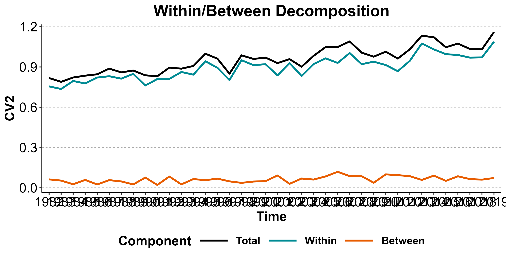
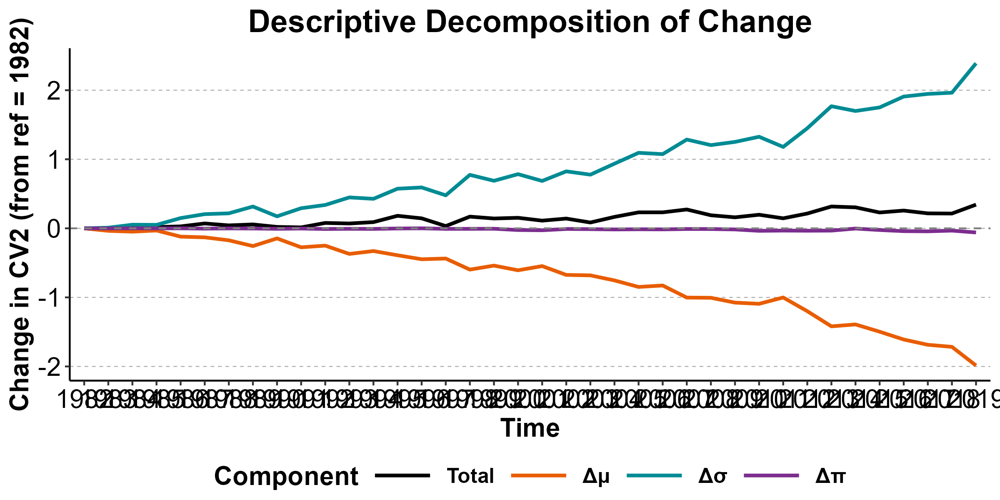
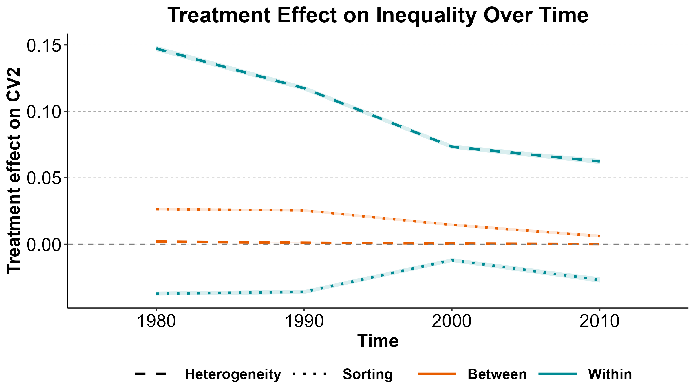
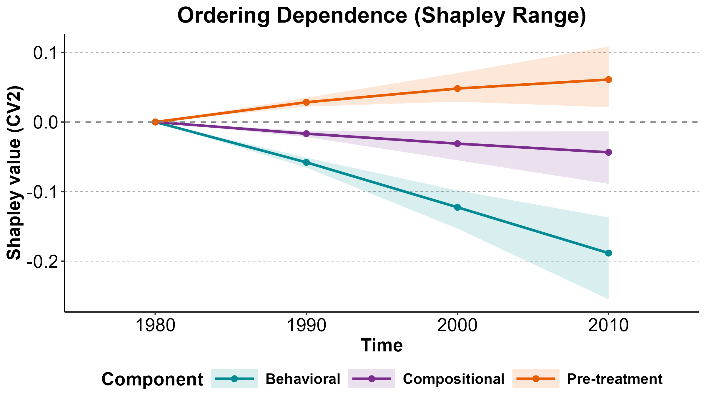

# Examples

Two short worked examples. Both run on the package’s bundled
`earnings_panel` (a synthetic, CPS-style two-wave panel of 7,600 women,
1982–2020; see
[`?earnings_panel`](https://benrosche.github.io/ineqx/reference/earnings_panel.md))
and aim to show the package’s two main modes — descriptive and causal —
without doing a full analysis.

- [Example 1: Descriptive within/between decomposition](#e1)
- [Example 2: Causal decomposition — the motherhood penalty](#e2)

``` r

library(ineqx)
data("earnings_panel")
```

------------------------------------------------------------------------

### Example 1: Descriptive within/between decomposition

Women in `earnings_panel` are grouped into low/middle/high socioeconomic
status (`ses`). We ask: how much earnings inequality lies *within* each
SES tier vs *between* tiers, and how has that changed since 1982? For a
clean annual cross-section we use each woman’s first wave (`post == 0`).

``` r

desc <- ineqx(
  y = "earnweek", ystat = "CV2",
  group = "ses",
  time = "year", ref = 1982,
  weights = "earnwt",
  data = subset(earnings_panel, post == 0)
)
```

We use `ystat = "CV2"` (squared coefficient of variation,
$`\sigma^2/\mu^2`$) rather than `"Var"` so that the high-income tier
doesn’t mechanically dominate the decomposition. `"VL"` (variance of
logs) is also accepted but is generally not recommended — see the FAQ.

``` r

print(desc)
#> Descriptive variance decomposition
#> Inequality measure: CV2 
#> Reference period: 1982 
#> Ordering: shapley 
#> 
#> Totals by time:
#>  time   CV2W    CV2B   CV2T
#>  1982 0.7553 0.06219 0.8175
#>  1983 0.7361 0.05330 0.7894
#>  1984 0.7956 0.02597 0.8216
#>  1985 0.7771 0.05828 0.8354
#>  1986 0.8212 0.02440 0.8456
#>  1987 0.8311 0.05668 0.8878
#>  1988 0.8131 0.04695 0.8601
#>  1989 0.8488 0.02483 0.8736
#>  1990 0.7619 0.07605 0.8379
#>  1991 0.8103 0.02070 0.8310
#>  1992 0.8116 0.08374 0.8953
#>  1993 0.8626 0.02497 0.8876
#>  1994 0.8429 0.06463 0.9075
#>  1995 0.9427 0.05623 0.9989
#>  1996 0.8941 0.06791 0.9620
#>  1997 0.8027 0.04756 0.8503
#>  1998 0.9505 0.03630 0.9868
#>  1999 0.9138 0.04623 0.9600
#>  2000 0.9207 0.04921 0.9699
#>  2001 0.8375 0.09134 0.9289
#>  2002 0.9295 0.02917 0.9586
#>  2003 0.8332 0.06864 0.9019
#>  2004 0.9221 0.06098 0.9831
#>  2005 0.9643 0.08440 1.0487
#>  2006 0.9302 0.11880 1.0490
#>  2007 1.0038 0.08653 1.0903
#>  2008 0.9209 0.08580 1.0067
#>  2009 0.9396 0.03734 0.9769
#>  2010 0.9145 0.09964 1.0142
#>  2011 0.8687 0.09387 0.9625
#>  2012 0.9456 0.08618 1.0318
#>  2013 1.0752 0.05817 1.1334
#>  2014 1.0311 0.09023 1.1213
#>  2015 0.9955 0.05132 1.0469
#>  2016 0.9893 0.08531 1.0747
#>  2017 0.9697 0.06438 1.0341
#>  2018 0.9715 0.06029 1.0317
#>  2019 1.0878 0.07269 1.1605
#> 
#> Decomposition of changes in CV2 relative to ref = 1982:
#> 
#>   time 1982: (reference)
#> 
#>   time 1983:
#>     Between-group (delta_mu):                   -0.0362
#>       Between-group:                            -0.0082
#>       Within-group:                             -0.0279
#>     Within-group (delta_sigma):                  0.0094
#>     Compositional (delta_pi):                   -0.0013
#>       Between-group:                            -0.0006
#>       Within-group:                             -0.0007
#>     Total:                                      -0.0281
#> 
#>   time 1984:
#>     Between-group (delta_mu):                   -0.0482
#>       Between-group:                            -0.0367
#>       Within-group:                             -0.0115
#>     Within-group (delta_sigma):                  0.0523
#>     Compositional (delta_pi):                   -0.0000
#>       Between-group:                             0.0004
#>       Within-group:                             -0.0004
#>     Total:                                       0.0041
#> 
#>   time 1985:
#>     Between-group (delta_mu):                   -0.0312
#>       Between-group:                            -0.0037
#>       Within-group:                             -0.0275
#>     Within-group (delta_sigma):                  0.0501
#>     Compositional (delta_pi):                   -0.0011
#>       Between-group:                            -0.0003
#>       Within-group:                             -0.0008
#>     Total:                                       0.0179
#> 
#>   time 1986:
#>     Between-group (delta_mu):                   -0.1202
#>       Between-group:                            -0.0382
#>       Within-group:                             -0.0820
#>     Within-group (delta_sigma):                  0.1485
#>     Compositional (delta_pi):                   -0.0001
#>       Between-group:                             0.0004
#>       Within-group:                             -0.0005
#>     Total:                                       0.0281
#> 
#>   time 1987:
#>     Between-group (delta_mu):                   -0.1307
#>       Between-group:                            -0.0063
#>       Within-group:                             -0.1244
#>     Within-group (delta_sigma):                  0.2054
#>     Compositional (delta_pi):                   -0.0044
#>       Between-group:                             0.0008
#>       Within-group:                             -0.0051
#>     Total:                                       0.0703
#> 
#>   time 1988:
#>     Between-group (delta_mu):                   -0.1733
#>       Between-group:                            -0.0162
#>       Within-group:                             -0.1571
#>     Within-group (delta_sigma):                  0.2172
#>     Compositional (delta_pi):                   -0.0014
#>       Between-group:                             0.0010
#>       Within-group:                             -0.0023
#>     Total:                                       0.0426
#> 
#>   time 1989:
#>     Between-group (delta_mu):                   -0.2568
#>       Between-group:                            -0.0385
#>       Within-group:                             -0.2183
#>     Within-group (delta_sigma):                  0.3155
#>     Compositional (delta_pi):                   -0.0027
#>       Between-group:                             0.0012
#>       Within-group:                             -0.0038
#>     Total:                                       0.0561
#> 
#>   time 1990:
#>     Between-group (delta_mu):                   -0.1460
#>       Between-group:                             0.0128
#>       Within-group:                             -0.1588
#>     Within-group (delta_sigma):                  0.1737
#>     Compositional (delta_pi):                   -0.0073
#>       Between-group:                             0.0011
#>       Within-group:                             -0.0083
#>     Total:                                       0.0204
#> 
#>   time 1991:
#>     Between-group (delta_mu):                   -0.2746
#>       Between-group:                            -0.0428
#>       Within-group:                             -0.2319
#>     Within-group (delta_sigma):                  0.2911
#>     Compositional (delta_pi):                   -0.0030
#>       Between-group:                             0.0013
#>       Within-group:                             -0.0042
#>     Total:                                       0.0135
#> 
#>   time 1992:
#>     Between-group (delta_mu):                   -0.2507
#>       Between-group:                             0.0224
#>       Within-group:                             -0.2730
#>     Within-group (delta_sigma):                  0.3381
#>     Compositional (delta_pi):                   -0.0097
#>       Between-group:                            -0.0008
#>       Within-group:                             -0.0088
#>     Total:                                       0.0778
#> 
#>   time 1993:
#>     Between-group (delta_mu):                   -0.3704
#>       Between-group:                            -0.0379
#>       Within-group:                             -0.3325
#>     Within-group (delta_sigma):                  0.4476
#>     Compositional (delta_pi):                   -0.0071
#>       Between-group:                             0.0006
#>       Within-group:                             -0.0078
#>     Total:                                       0.0701
#> 
#>   time 1994:
#>     Between-group (delta_mu):                   -0.3290
#>       Between-group:                             0.0018
#>       Within-group:                             -0.3308
#>     Within-group (delta_sigma):                  0.4274
#>     Compositional (delta_pi):                   -0.0084
#>       Between-group:                             0.0006
#>       Within-group:                             -0.0090
#>     Total:                                       0.0900
#> 
#>   time 1995:
#>     Between-group (delta_mu):                   -0.3899
#>       Between-group:                            -0.0066
#>       Within-group:                             -0.3834
#>     Within-group (delta_sigma):                  0.5736
#>     Compositional (delta_pi):                   -0.0023
#>       Between-group:                             0.0006
#>       Within-group:                             -0.0029
#>     Total:                                       0.1814
#> 
#>   time 1996:
#>     Between-group (delta_mu):                   -0.4476
#>       Between-group:                             0.0036
#>       Within-group:                             -0.4512
#>     Within-group (delta_sigma):                  0.5920
#>     Compositional (delta_pi):                    0.0001
#>       Between-group:                             0.0022
#>       Within-group:                             -0.0020
#>     Total:                                       0.1445
#> 
#>   time 1997:
#>     Between-group (delta_mu):                   -0.4375
#>       Between-group:                            -0.0154
#>       Within-group:                             -0.4221
#>     Within-group (delta_sigma):                  0.4781
#>     Compositional (delta_pi):                   -0.0078
#>       Between-group:                             0.0008
#>       Within-group:                             -0.0086
#>     Total:                                       0.0328
#> 
#>   time 1998:
#>     Between-group (delta_mu):                   -0.5976
#>       Between-group:                            -0.0281
#>       Within-group:                             -0.5695
#>     Within-group (delta_sigma):                  0.7743
#>     Compositional (delta_pi):                   -0.0074
#>       Between-group:                             0.0022
#>       Within-group:                             -0.0096
#>     Total:                                       0.1693
#> 
#>   time 1999:
#>     Between-group (delta_mu):                   -0.5398
#>       Between-group:                            -0.0182
#>       Within-group:                             -0.5216
#>     Within-group (delta_sigma):                  0.6884
#>     Compositional (delta_pi):                   -0.0061
#>       Between-group:                             0.0022
#>       Within-group:                             -0.0083
#>     Total:                                       0.1425
#> 
#>   time 2000:
#>     Between-group (delta_mu):                   -0.6074
#>       Between-group:                            -0.0159
#>       Within-group:                             -0.5915
#>     Within-group (delta_sigma):                  0.7844
#>     Compositional (delta_pi):                   -0.0245
#>       Between-group:                             0.0029
#>       Within-group:                             -0.0274
#>     Total:                                       0.1524
#> 
#>   time 2001:
#>     Between-group (delta_mu):                   -0.5468
#>       Between-group:                             0.0272
#>       Within-group:                             -0.5739
#>     Within-group (delta_sigma):                  0.6862
#>     Compositional (delta_pi):                   -0.0281
#>       Between-group:                             0.0020
#>       Within-group:                             -0.0301
#>     Total:                                       0.1114
#> 
#>   time 2002:
#>     Between-group (delta_mu):                   -0.6744
#>       Between-group:                            -0.0312
#>       Within-group:                             -0.6432
#>     Within-group (delta_sigma):                  0.8250
#>     Compositional (delta_pi):                   -0.0095
#>       Between-group:                            -0.0018
#>       Within-group:                             -0.0077
#>     Total:                                       0.1411
#> 
#>   time 2003:
#>     Between-group (delta_mu):                   -0.6811
#>       Between-group:                             0.0038
#>       Within-group:                             -0.6849
#>     Within-group (delta_sigma):                  0.7772
#>     Compositional (delta_pi):                   -0.0117
#>       Between-group:                             0.0026
#>       Within-group:                             -0.0143
#>     Total:                                       0.0844
#> 
#>   time 2004:
#>     Between-group (delta_mu):                   -0.7542
#>       Between-group:                            -0.0030
#>       Within-group:                             -0.7512
#>     Within-group (delta_sigma):                  0.9361
#>     Compositional (delta_pi):                   -0.0163
#>       Between-group:                             0.0018
#>       Within-group:                             -0.0181
#>     Total:                                       0.1656
#> 
#>   time 2005:
#>     Between-group (delta_mu):                   -0.8486
#>       Between-group:                             0.0236
#>       Within-group:                             -0.8722
#>     Within-group (delta_sigma):                  1.0934
#>     Compositional (delta_pi):                   -0.0135
#>       Between-group:                            -0.0014
#>       Within-group:                             -0.0121
#>     Total:                                       0.2312
#> 
#>   time 2006:
#>     Between-group (delta_mu):                   -0.8279
#>       Between-group:                             0.0565
#>       Within-group:                             -0.8844
#>     Within-group (delta_sigma):                  1.0744
#>     Compositional (delta_pi):                   -0.0151
#>       Between-group:                             0.0001
#>       Within-group:                             -0.0152
#>     Total:                                       0.2315
#> 
#>   time 2007:
#>     Between-group (delta_mu):                   -1.0027
#>       Between-group:                             0.0231
#>       Within-group:                             -1.0259
#>     Within-group (delta_sigma):                  1.2853
#>     Compositional (delta_pi):                   -0.0098
#>       Between-group:                             0.0012
#>       Within-group:                             -0.0110
#>     Total:                                       0.2728
#> 
#>   time 2008:
#>     Between-group (delta_mu):                   -1.0059
#>       Between-group:                             0.0218
#>       Within-group:                             -1.0277
#>     Within-group (delta_sigma):                  1.2052
#>     Compositional (delta_pi):                   -0.0100
#>       Between-group:                             0.0018
#>       Within-group:                             -0.0118
#>     Total:                                       0.1892
#> 
#>   time 2009:
#>     Between-group (delta_mu):                   -1.0757
#>       Between-group:                            -0.0255
#>       Within-group:                             -1.0503
#>     Within-group (delta_sigma):                  1.2514
#>     Compositional (delta_pi):                   -0.0162
#>       Between-group:                             0.0006
#>       Within-group:                             -0.0168
#>     Total:                                       0.1594
#> 
#>   time 2010:
#>     Between-group (delta_mu):                   -1.0930
#>       Between-group:                             0.0356
#>       Within-group:                             -1.1286
#>     Within-group (delta_sigma):                  1.3259
#>     Compositional (delta_pi):                   -0.0362
#>       Between-group:                             0.0019
#>       Within-group:                             -0.0381
#>     Total:                                       0.1967
#> 
#>   time 2011:
#>     Between-group (delta_mu):                   -1.0014
#>       Between-group:                             0.0322
#>       Within-group:                             -1.0336
#>     Within-group (delta_sigma):                  1.1789
#>     Compositional (delta_pi):                   -0.0325
#>       Between-group:                            -0.0005
#>       Within-group:                             -0.0320
#>     Total:                                       0.1450
#> 
#>   time 2012:
#>     Between-group (delta_mu):                   -1.2001
#>       Between-group:                             0.0271
#>       Within-group:                             -1.2272
#>     Within-group (delta_sigma):                  1.4492
#>     Compositional (delta_pi):                   -0.0348
#>       Between-group:                            -0.0031
#>       Within-group:                             -0.0317
#>     Total:                                       0.2143
#> 
#>   time 2013:
#>     Between-group (delta_mu):                   -1.4192
#>       Between-group:                            -0.0023
#>       Within-group:                             -1.4169
#>     Within-group (delta_sigma):                  1.7679
#>     Compositional (delta_pi):                   -0.0328
#>       Between-group:                            -0.0017
#>       Within-group:                             -0.0311
#>     Total:                                       0.3159
#> 
#>   time 2014:
#>     Between-group (delta_mu):                   -1.3919
#>       Between-group:                             0.0356
#>       Within-group:                             -1.4275
#>     Within-group (delta_sigma):                  1.6990
#>     Compositional (delta_pi):                   -0.0033
#>       Between-group:                            -0.0076
#>       Within-group:                              0.0043
#>     Total:                                       0.3038
#> 
#>   time 2015:
#>     Between-group (delta_mu):                   -1.4968
#>       Between-group:                            -0.0066
#>       Within-group:                             -1.4902
#>     Within-group (delta_sigma):                  1.7506
#>     Compositional (delta_pi):                   -0.0245
#>       Between-group:                            -0.0043
#>       Within-group:                             -0.0202
#>     Total:                                       0.2294
#> 
#>   time 2016:
#>     Between-group (delta_mu):                   -1.6100
#>       Between-group:                             0.0266
#>       Within-group:                             -1.6366
#>     Within-group (delta_sigma):                  1.9080
#>     Compositional (delta_pi):                   -0.0408
#>       Between-group:                            -0.0035
#>       Within-group:                             -0.0373
#>     Total:                                       0.2571
#> 
#>   time 2017:
#>     Between-group (delta_mu):                   -1.6863
#>       Between-group:                             0.0043
#>       Within-group:                             -1.6907
#>     Within-group (delta_sigma):                  1.9463
#>     Compositional (delta_pi):                   -0.0434
#>       Between-group:                            -0.0021
#>       Within-group:                             -0.0412
#>     Total:                                       0.2166
#> 
#>   time 2018:
#>     Between-group (delta_mu):                   -1.7163
#>       Between-group:                            -0.0019
#>       Within-group:                             -1.7144
#>     Within-group (delta_sigma):                  1.9638
#>     Compositional (delta_pi):                   -0.0333
#>       Between-group:                            -0.0000
#>       Within-group:                             -0.0332
#>     Total:                                       0.2142
#> 
#>   time 2019:
#>     Between-group (delta_mu):                   -1.9868
#>       Between-group:                             0.0109
#>       Within-group:                             -1.9977
#>     Within-group (delta_sigma):                  2.3896
#>     Compositional (delta_pi):                   -0.0598
#>       Between-group:                            -0.0005
#>       Within-group:                             -0.0594
#>     Total:                                       0.3430
```

Within- vs between-group inequality over time:

``` r

plot(desc, type = "wibe")
```



Decomposition of the change since 1982 into contributions from changing
means ($`\Delta_\mu`$), changing dispersions ($`\Delta_\sigma`$), and
changing group shares ($`\Delta_\pi`$):

``` r

plot(desc, type = "decomp")
```



$`CV^2`$ rises from about 0.8 in 1982 to about 1.2 in 2019, and almost
all of that inequality — and its growth — lies *within* SES tiers. The
increase traces to growing within-group dispersion ($`\Delta_\sigma`$),
partly offset by rising mean earnings ($`\Delta_\mu`$), which lower
$`CV^2`$ for a given standard deviation. Shifts in the SES composition
($`\Delta_\pi`$) play almost no role. This is the basic motivation for
taking within-group inequality seriously.

------------------------------------------------------------------------

### Example 2: Causal decomposition — the motherhood penalty

Same dataset, now asking a causal question: how does motherhood affect
earnings inequality among women, and how has that effect changed?

We restrict the sample to women with positive earnings and fit a
difference-in-differences model (treatment = `mother`, post-period =
`post`) with education-by-decade interactions for both the mean and
log-SD of earnings. GAMLSS does the heavy lifting internally. For
`ystat = "CV2"`, keep the outcome in levels and use `post` for the DiD
contrast; applying `CV2` to first-differenced outcomes is not
recommended.

``` r

df <- subset(earnings_panel, earnweek > 0)

causal <- ineqx(
  y = "earnweek", ystat = "CV2",
  treat = "mother", post = "post",
  group = "educ",
  time = "decade", ref = 1980,
  formula_mu    = ~ mother * post * educ * factor(decade) + age,
  formula_sigma = ~ mother * post * educ * factor(decade),
  weights = "earnwt",
  se = "delta",
  data = df
)
#> GAMLSS-RS iteration 1: Global Deviance = 397555473 
#> GAMLSS-RS iteration 2: Global Deviance = 397532171 
#> GAMLSS-RS iteration 3: Global Deviance = 397532169 
#> GAMLSS-RS iteration 4: Global Deviance = 397532169
```

#### Cross-sectional split: het and cov sub-components

The treatment effect on inequality at each time decomposes into
$`\tau_B = \text{het}_B + \text{cov}_B`$ (between groups) and
$`\tau_W = \text{het}_W + \text{cov}_W`$ (within groups). See the [Model
structure](https://benrosche.github.io/ineqx/articles/model.md) page for
the exact formulas. `plot(..., type = "wibe", stats = ...)` shows all
four series at once:

``` r

plot(causal, type = "wibe",
     stats = c("het_b", "cov_b", "het_w", "cov_w"),
     ci = TRUE)
```



The dominant series here is **`het_W`** — the within-group component
driven by the average treatment effect on log-SD ($`\bar\lambda`$). It
is positive and large: motherhood widens within-education earnings
dispersion, though less so in later decades. The within-group
**`cov_W`** term is negative and the between-group **`cov_B`** term
(sorting of mean effects $`\beta`$ across education groups) is small and
positive: the motherhood penalty is largest in the lowest-earning
education group, which widens between-group gaps. Note this is exactly
the kind of pattern that mean-based methods miss.

#### Longitudinal: behavioral / compositional / pre-treatment

How has the motherhood effect’s contribution to inequality *changed*
since 1980? `type = "shapley"` displays the three-channel decomposition
with the range across the six possible orderings:

``` r

plot(causal, type = "shapley")
```



The **behavioral** channel ($`\Delta_\beta + \Delta_\lambda`$, how
motherhood’s per-group effects have changed) is the largest and negative
— the motherhood penalties on both the mean and the dispersion of
earnings have shrunk since 1980, so motherhood adds less to inequality
than it used to. The **compositional** channel ($`\Delta_\pi`$) is also
negative: the share of women who become mothers has fallen.
**Pre-treatment** shifts ($`\Delta_\mu +
\Delta_\sigma`$, changes in baseline inequality) push in the opposite
direction: because baseline earnings have become more unequal, the same
treatment effects now contribute more to inequality.

A more thorough analysis would add controls for race, marital status,
and age splines; would model the pre-trends formally; and would use
bootstrap rather than delta-method SEs. See
[`?ineqx`](https://benrosche.github.io/ineqx/reference/ineqx.md),
[`?boot_config`](https://benrosche.github.io/ineqx/reference/boot_config.md),
and the
[Tutorial](https://benrosche.github.io/ineqx/articles/tutorial.md) for
the full toolbox.
